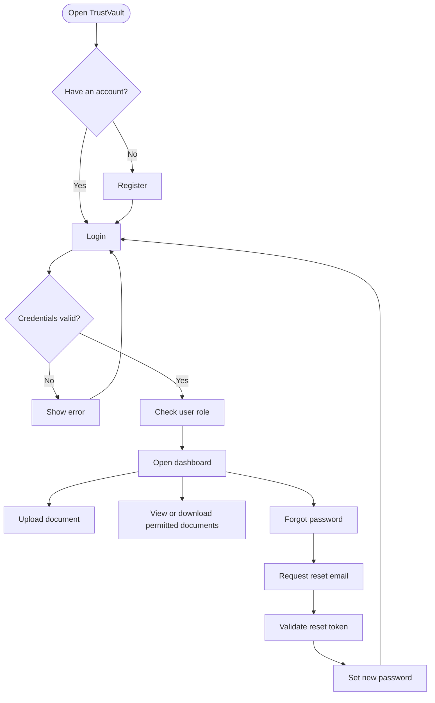

# TrustVault – Secure Document Management Platform

## Overview
TrustVault is a secure web application designed to manage confidential documents. It provides user authentication, role-based access control, document upload and download, and email-based password recovery.

## Features
- User registration and login
- Role-based access for Admin, Document Owner, and Viewer
- Secure document upload and download
- Email-based password reset
- Expiring password reset tokens
- Password hashing and CSRF protection
- SQLite database for local development

## Application Workflow


## Technology Stack
- **Frontend:** React, Vite, JavaScript, CSS
- **Backend:** Python, Flask
- **Database:** SQLite
- **Email:** Gmail SMTP

## Project Structure
- `client/` – React frontend
- `server/app.py` – Flask backend application
- `server/schema.sql` – Database schema
- `server/init_db.py` – Database initialization
- `server/requirements.txt` – Python dependencies
- `PROMPTS.md` – AI prompts and development notes

## Run Locally

### Backend
From the project root, activate your virtual environment and run:

```powershell
.\.venv\Scripts\Activate.ps1
pip install -r .\server\requirements.txt
python .\server\init_db.py
python .\server\app.py
```

### Frontend
Open a second terminal and run:

```powershell
cd client
npm install
npm run dev
```

Open the local URL displayed by Vite in your browser.

## Email Configuration
Configure required email credentials through environment variables in `server/.env`. Never publish credentials or `.env` files.

## Security Notes
- Keep passwords, email credentials, and other secrets out of GitHub.
- Configure production API URLs and allowed origins before deployment.
- Use HTTPS and suitable production security settings.

## Deployment
The frontend and backend require separate production configuration. Add the verified live application URL after deployment.

## License
Follow the license requirements specified by the project challenge.
## Application Workflow




